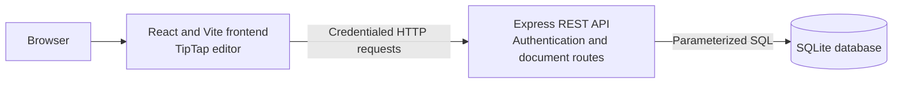
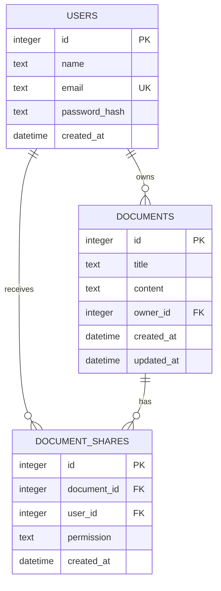
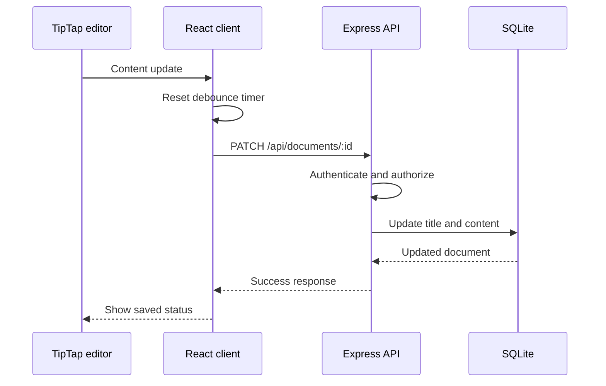

# Ajaia Docs Architecture

## 1. System overview

Ajaia Docs separates the browser experience, API operations, and persistent storage.



Authentication uses a JWT in an HTTP-only cookie. DOCX imports travel from the browser to the API as multipart form data, where the server processes the file before saving a document.

## 2. Technology choices

| Technology | Role in this project |
| --- | --- |
| React | Builds the interactive application UI and manages session and document state. |
| Vite | Provides the frontend development server and production build. |
| TipTap | Provides the rich-text editor and structured JSON document model. |
| Node.js | Runs the backend JavaScript application. |
| Express | Defines middleware and REST route handlers. |
| SQLite | Stores users, documents, and sharing records in a local database. |
| better-sqlite3 | Provides synchronous SQLite access and bound SQL parameters. |
| JWT | Represents the authenticated session between login and token expiry. |
| bcryptjs | Hashes seeded passwords and compares login credentials. |
| Multer | Receives uploaded files in memory and enforces the configured upload limit. |
| Mammoth | Converts DOCX input to HTML for text extraction. |

These choices provide a small full-stack setup without a separate database service or collaboration infrastructure.

## 3. Repository structure

```text
client/
  src/
    App.jsx          Application, authentication, documents, and save behavior
    Toolbar.jsx      TipTap formatting controls
    api.js           Credentialed API request helper
    main.jsx         React entry point
    styles.css       Application styles
  package.json       Frontend scripts and dependencies

server/
  src/
    app.js           Express setup and route mounting
    routes/          Authentication and document endpoints
    middleware/      JWT authentication middleware
    db/              SQLite connection, schema, and seed data
    config/          Environment configuration
  test/              Backend automated test
```

The client owns presentation and editor state. The server owns authentication, authorization, validation, file processing, and database access.

## 4. Frontend architecture

The React application contains the login view and the authenticated document workspace. The workspace separates owned documents from shared documents, supports client-side title search, displays the current user, and provides document create, import, share, duplicate, and delete actions.

TipTap is configured with paragraph, heading, bold, italic, underline, and list support. Its JSON document is serialized for API updates and parsed when a document is opened. The formatting toolbar is implemented separately from the main application component.

The API helper targets the configured backend host, adds the `/api` prefix, and sends requests with `credentials: "include"`. It avoids setting a JSON content type for `FormData` requests so the browser can supply the multipart boundary.

Edits trigger a debounced `PATCH` request. The interface reports `Saving...`, `Saved`, or `Save failed`. Word and character counts are derived from TipTap's plain-text content. The client does not implement offline synchronization or concurrent-edit conflict resolution.

## 5. Backend architecture

`server/src/app.js` initializes the schema, configures CORS, JSON parsing, and cookie parsing, then mounts the authentication and document routers. Authentication routes issue, verify, or clear the session cookie. The document router applies JWT authentication before its handlers. It also exposes owner-controlled deletion, access-aware duplication, and authenticated AI summarization.

The database module opens the SQLite file and enables foreign-key enforcement. The schema defines user, document, and document-share tables. Route handlers use prepared statements with bound parameters for database operations.

## 6. Authentication flow

1. The client submits an email and password to `POST /api/auth/login`.
2. The server finds the user and compares the submitted password with the bcrypt hash.
3. The server signs a JWT and sets it in the `auth_token` HTTP-only cookie.
4. The client includes browser credentials on subsequent requests.
5. Authentication middleware verifies the JWT and attaches its user claims to the request.
6. `GET /api/auth/me` returns the current user; `POST /api/auth/logout` clears the cookie.

There is no registration, OAuth, or password-reset flow in the current application.

## 7. Authorization model

A document is accessible to a user when that user owns it or has a corresponding record in `document_shares`. The backend enforces this rule in document listing, retrieval, and update routes. Only the owner can share a document. The current share flow grants editing access; the database has a `permission` column, but access checks use the presence of the share record.

The UI may distinguish owned and shared documents, but it is not the authorization boundary. API requests are checked server-side.

The document response includes access details for the current viewer. Owners receive their own identity and the users shared with that document. A shared user receives the owner's name and their own permission, without a list of other recipients.

## 8. Database design



The schema applies cascading foreign keys for owned documents and share records. A unique constraint on `(document_id, user_id)` prevents duplicate share relationships.

## 9. Document data model

The `documents.content` column stores a JSON-serialized TipTap document. For example:

```json
{
  "type": "doc",
  "content": [
    {
      "type": "paragraph",
      "content": [{ "type": "text", "text": "Hello Ajaia Docs" }]
    }
  ]
}
```

The server stores the serialized value as text. When opened, the client parses it and passes the document structure to TipTap.

## 10. Autosave flow



The client waits approximately 800 ms after an edit before sending the update. A failed update is surfaced as `Save failed`.

## 11. Sharing flow

The owner submits a target user's email to `POST /api/documents/:id/share`. The backend confirms the document exists, verifies that the requester owns it, looks up the target user, prevents self-sharing, and inserts or updates the share row. A shared user can then list, open, and edit the document through protected document routes.

## 12. DOCX import flow

1. The browser submits the selected file as `multipart/form-data` to `POST /api/documents/import`.
2. Multer stores the file in memory and limits it to 5 MB.
3. The route checks the DOCX MIME type or `.docx` extension.
4. Mammoth converts the file to HTML.
5. The current implementation strips HTML tags and places the resulting text into a TipTap paragraph.
6. The server creates a document owned by the authenticated user.

This is text extraction, not full Word conversion. Tables, images, and advanced layout are not preserved by the current conversion.

## 13. AI summarization

The client sends an authenticated `POST /api/documents/:id/summarize` request. The backend verifies ownership or share access, parses the stored TipTap JSON, extracts plain text, and rejects empty content or input above 30,000 characters. It calls the configured provider through `server/src/services/summarizer.js` and returns the summary in the response. The summary is transient and is not written into the document.

The current provider adapter uses OpenAI's Responses API via server-side `fetch`. `OPENAI_API_KEY` is read from the server environment, and `OPENAI_MODEL` can select a model. Missing key configuration returns a service error; the key is never sent to the client. The provider-specific request and response handling is isolated in the service module.

## 14. API design

All routes are mounted under `/api`.

| Method | Route | Responsibility |
| --- | --- | --- |
| `POST` | `/api/auth/login` | Validate credentials and set the JWT cookie |
| `GET` | `/api/auth/me` | Return the authenticated user |
| `POST` | `/api/auth/logout` | Clear the cookie |
| `GET` | `/api/documents` | List documents owned by or shared with the user |
| `POST` | `/api/documents` | Create a document for the authenticated user |
| `GET` | `/api/documents/:id` | Return a document after access checks |
| `PATCH` | `/api/documents/:id` | Update document title and/or content |
| `DELETE` | `/api/documents/:id` | Delete a document as its owner |
| `POST` | `/api/documents/:id/duplicate` | Copy an accessible document into the caller's ownership |
| `POST` | `/api/documents/:id/share` | Create or update a document share |
| `POST` | `/api/documents/import` | Convert an uploaded DOCX into a document |
| `POST` | `/api/documents/:id/summarize` | Return a transient AI-generated summary |

## 15. Error handling and validation

Routes return structured JSON errors with HTTP status codes for missing input, invalid IDs, authentication failures, denied access, missing documents or users, and DOCX import failures. The API helper turns non-success responses into errors displayed by the client.

DOCX uploads require a file and are limited by Multer to 5 MB. The route checks the MIME type or filename extension. Document IDs are checked as integers; title and content updates are checked as strings.

Delete is restricted to the document owner. Duplication and summarization require document access. Summarization rejects invalid stored JSON, empty text, and documents above its configured character limit.

## 16. Security boundaries

- Passwords are stored as bcrypt hashes.
- The session JWT is sent in an HTTP-only cookie and verified by middleware.
- Document ownership and share membership are checked by backend routes.
- SQL values are bound through prepared statements.
- DOCX uploads have a size limit and a DOCX type/extension check.
- The LLM API key is read and used on the server; document text is sent only after a backend access check.

The development JWT secret is a fallback, not a production secret. Production should use HTTPS, a strong configured secret, suitable cookie settings, an explicit CORS policy, and persistent storage.

## 17. Testing

The automated test uses Node.js's built-in test runner. It verifies that unauthenticated requests to document listing, deletion, duplication, and summarization receive `401 Unauthorized`. The documented test run passes one test with zero failures. The frontend production build succeeds; Vite reports a bundle-size advisory for a chunk above 500 KB.

Manual verification areas include login, document creation and editing, autosave, reopening, sharing and shared editing, persistence, and DOCX import. These checks do not imply broader automated coverage.

## 18. Engineering trade-offs

The MVP uses request-based autosave rather than real-time synchronization. CRDT/OT, live cursors, offline conflict handling, comments, version history, public links, complex roles, and account-management flows were excluded to keep the implementation focused on the core document workflow.

DOCX import extracts text rather than attempting full Word fidelity. Seeded accounts replace registration and password recovery. SQLite provides local relational persistence without a separate database service.

## 19. Future extensions

Possible follow-up work includes real-time collaboration, comments, version history, more granular sharing permissions, account registration, richer DOCX conversion, export formats, and migration to a server database for larger deployments. These are not part of the current implementation.
